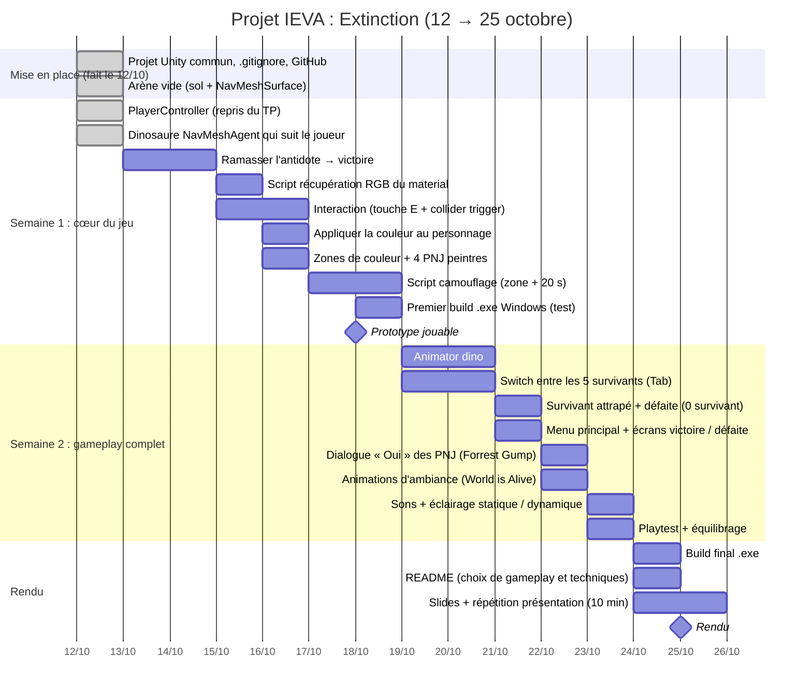

# Planning du projet IEVA : 12 → 25 octobre 2026

**Groupe 6** : Kenan & Alexandre. **Thème** : Extinction. **Mécaniques** : Matcher, Surpasser.
**Diversifiers** : The World is Alive, Herding cats, Forrest Gump.

## Le jeu (version réaliste)

Cinq survivants doivent récupérer l'antidote gardé par un dinosaure. L'arène est divisée en zones de couleur.
Le joueur contrôle un survivant à la fois et passe de l'un à l'autre avec `Tab`.
En parlant aux PNJ des coins (une seule réponse possible : « Oui »), le survivant prend leur couleur.
Si sa couleur correspond à la zone où il se trouve, il est caché du dinosaure pendant 20 s.
Le dinosaure patrouille, puis poursuit les survivants visibles.
**Victoire** : ramasser l'antidote. **Défaite** : les 5 survivants sont attrapés.

On part des scripts du TP d'intro (`PlayerController`, `SingleAgentController`, `ChomperBehaviour`, `OpenLevel`, `PlatformSpawner`)
et on avance par petites étapes, une scène de test par fonctionnalité si besoin.

## Avancement

**Lundi 12 octobre** : étapes 0, 1 et 2 du mail de Yann terminées.

- [x] Projet Unity commun `IEVADINO` (Unity 6, URP) + `.gitignore`
- [x] Player Controller : `PlayerController.cs` du TP, sur le prefab du bonhomme vert du TP
- [x] PNJ dinosaure : cylindre + NavMeshAgent + `DinoController.cs` (repris de `SingleAgentController`), NavMeshSurface sur le sol
- [ ] Ramasser un objet pour gagner
- [ ] Récupérer le RGB d'un material
- [ ] Interaction (touche + collider)
- [ ] Appliquer la couleur au personnage
- [ ] Placer les PNJ / objets qui donnent les couleurs
- [ ] Script caché (20 s)
- [ ] Animator / machine à états du dinosaure
- [ ] Scripts perdre et gagner

## Diagramme de Gantt

## Répartition (à ajuster)

| Date | Alexandre | Kenan | Ce qu'on réutilise du TP |
|---|---|---|---|
| Lun 12 ✅ | Projet Unity commun, `.gitignore`, `PlayerController` sur le prefab du TP | Arène vide + NavMeshSurface, dino NavMeshAgent qui suit le joueur | `PlayerController.cs`, `MyFirstPrefab`, `SingleAgentController.cs` |
| Mar 13 – Mer 14 | Ramasser l'antidote → victoire | Avance sur l'interaction (touche + collider) | `PlatformSpawner.cs` (OnTriggerEnter) |
| Jeu 15 | Récupération du RGB du material | Script d'interaction (touche + collider) | |
| Ven 16 | Appliquer la couleur au personnage | Zones de couleur + 4 PNJ peintres | Materials du TP |
| Sam 17 – Dim 18 | Camouflage + premier build .exe | Camouflage (détection de zone) | |
| Lun 19 – Mar 20 | Switch entre les 5 survivants | Animator dino : Patrouille / Poursuite | `ChomperBehaviour.cs`, Chomper du TP |
| Mer 21 | Menu + écrans victoire / défaite | Survivant attrapé, condition de défaite | `OpenLevel.cs`, scène 0_MainMenu |
| Jeu 22 | Dialogue « Oui » | Animations d'ambiance | |
| Ven 23 | Playtest + équilibrage | Sons + éclairage | scène 5_LightingAndPhysics |
| Sam 24 | Build final + README | Slides | |
| Dim 25 | Répétition, marge | Répétition, marge | |

## Grille du prof : où chaque critère est couvert

| Critère | Tâche |
|---|---|
| Menu principal | b4 |
| On peut gagner / perdre | a4, b3 |
| Contrôleurs efficaces | a2, b2 |
| Interaction avec l'environnement | a6, a7, b5 |
| Audio | b7 |
| Navigation (NavMesh) | a1, a3, b1 |
| Physique | a6 (colliders, triggers) |
| Modèles 3D | Chomper du TP + primitives |
| Éclairage statique / dynamique | b7 |
| .exe | a10, c1 |
| Mécaniques du cours | Matcher (a9), Surpasser (b1) |

## Hors périmètre (seulement si on est en avance)

- Traits différents par survivant (vitesse, crochetage…)
- Plusieurs fragments d'antidote dans des coffres
- Peinture qui s'efface plus lentement sur les persos inactifs
- Dino qui accélère au fil de la partie
