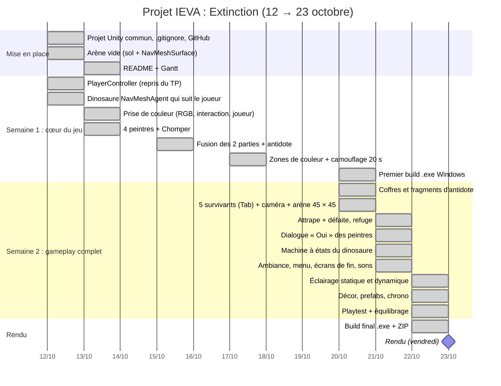

# Extinction — projet IEVA (groupe 6 : Kenan & Alexandre)

- **Thème** : GGJ 2011 « Extinction »
- **Mécaniques** : Matcher (prendre la couleur du sol pour se cacher), Surpasser (échapper au dinosaure, et au temps)
- **Diversifiers** : 5 *The World is Alive* (décor animé), 16 *Herding cats* (5 personnages contrôlés), 21 *Forrest Gump* (seule réponse possible : « Oui »)

## Le jeu

Cinq survivants partent d'un refuge pour reconstituer l'antidote qui sauvera l'humanité. Les trois fragments d'antidote sont cachés dans des coffres, au milieu d'une arène gardée par un dinosaure. Il reste **3 minutes**.

- On contrôle un survivant à la fois et on passe de l'un à l'autre avec `Tab`. Les autres restent sur place.
- Les survivants partent d'un **refuge** relié à l'arène par une passerelle : le dinosaure ne peut pas y entrer.
- Les peintres des quatre coins colorent le survivant (rouge, jaune, vert ou bleu). On ne peut leur répondre que « Oui ».
- Sur une zone de sa couleur, le survivant est caché du dinosaure pendant 20 s, puis la peinture sèche.
- Un coffre ne s'ouvre qu'avec la couleur de la zone où il est posé. Trois coffres sur huit, tirés au hasard, contiennent un fragment.
- Le dinosaure patrouille, poursuit le survivant actif dès qu'il est visible, et l'attrape s'il le touche : on passe alors au survivant suivant.

**Victoire** : réunir les 3 fragments avant la fin du chrono. **Défaite** : les cinq survivants sont attrapés, ou le temps est écoulé.

## Lancer le jeu

- **Exécutable** : lancer `Build/IEVADINO.exe` fourni dans le ZIP (Windows).
- **Projet** : ouvrir le dossier `IEVADINO` avec **Unity 6000.3.24f1**, ouvrir la scène `Assets/Scenes/Menu.unity`, puis Play.

| Action | Touche |
|---|---|
| Avancer / reculer, tourner | Flèches directionnelles |
| Changer de survivant | `Tab` |
| Parler à un peintre, répondre « Oui », ouvrir un coffre | `E` |

## Qui a fait quoi

**Kenan**
- Prise de couleur : lecture du RGB d'un material, interaction avec la touche E, couleur appliquée au personnage (`ColorSource`, `ColorInteraction`, `PlayerColor`)
- Dinosaure Chomper : intégration du modèle du TP et passage des materials en URP
- Zones de couleur et camouflage de 20 s (`PlayerHiding`)
- Arène 45 × 45, caméra qui suit le survivant actif, 5 survivants et changement avec `Tab` (`Survivor`, `SurvivorManager`, `SurvivorHud`, `CameraFollow`)
- Machine à états du dinosaure dans l'Animator : Patrouille, Poursuite, Attaque, un script par état (`DinoPatrolState`, `DinoChaseState`, `DinoAttackState`, `DinoSettings`)
- Animations d'ambiance (`AliveIdle`), décor d'arbres et de buissons, menu principal, écrans de victoire et de défaite, sons, musiques et pas du dinosaure
- Organisation finale du projet : scènes `Menu` et `Jeu`, prefabs `Dino` et `Peintre`

**Alexandre**
- Création du projet Unity commun, du dépôt GitHub, du README, du Gantt et des captures d'évolution
- Contrôleur du joueur repris du TP, puis passé en physique (Rigidbody, `FixedUpdate`), flèche de direction
- Premier dinosaure avec NavMesh, fusion des deux parties du projet
- Refactorisation en composants, événements et ScriptableObjects (`ColorData`, `GameRules`, `IInteractable`, `Interactor`)
- Logique de la partie (`GameManager`) : victoire (premier antidote, puis 3 fragments), défaite quand les 5 survivants sont attrapés (`DinoCatcher`) ou quand le temps est écoulé
- Chrono de 3 minutes et son panneau dans l'arène (`GameTimer`, `TimerBoard`)
- Construction de la carte (murs, obstacles, refuge et passerelle) et coffres contenant les fragments d'antidote (`Chest`, `ChestLoot`, `AntidoteFragment`)
- Refuge sûr et visibilité des survivants : le dinosaure abandonne une cible cachée ou au refuge (`SafeZone`, `Survivor`, `DinoController`)
- Dialogues « Oui » des peintres (`NpcDialogue`, `DialogueData`) et coffres verrouillés par couleur
- Éclairage statique et dynamique (lightmaps, light probes), prefabs du décor et des zones, vent dans les arbres
- Builds Windows

**Ensemble** : choix du concept et du gameplay, fusion des deux parties, tests et équilibrage.

## Choix techniques

**Composition plutôt qu'héritage.** Chaque comportement est un petit `MonoBehaviour` (38 lignes en moyenne), et les objets sont des assemblages de composants. Un survivant = `PlayerController` + `PlayerColor` + `PlayerHiding` + `Interactor` + `Survivor`. Tout ce qui se répète est un prefab : survivant, peintre, dinosaure, coffre, fragment, zone de couleur, arbre, buisson.

**Événements (`Action`).** Les scripts ne s'interrogent pas les uns les autres : ils publient des événements et d'autres s'y abonnent. Par exemple `Survivor.OnCaught`, `Survivor.OnVisibilityChanged`, `NpcDialogue.OnAccepted`, `GameTimer.OnTimeUp`, `GameManager.OnVictory` / `OnDefeat`. `GameSounds` et `EndScreen` ne font que s'abonner : aucun script de gameplay ne sait qu'ils existent.

**Le moins possible de logique dans `Update`.** Les durées passent par des coroutines (camouflage de 20 s, chrono, ouverture du couvercle, délai de ramassage du fragment) et les détections par des triggers (zones, peintres, coffres, refuge, capture). `Update` ne sert qu'à lire le clavier et à l'animation d'ambiance, la caméra suit en `LateUpdate`.

**Interfaces.** `IInteractable` est implémentée par le peintre (dialogue) et le coffre : l'`Interactor` du survivant ne connaît que l'interface, la touche E marche donc avec tout objet interactif. `ICatchable` est implémentée par le survivant et utilisée par `DinoCatcher`.

**ScriptableObject pour les données.** `ColorData` (les 4 couleurs : une zone et un survivant ont la même couleur s'ils pointent vers le même asset), `GameRules` (fragments à trouver, durée du chrono), `DinoSettings` (vitesses, zone de patrouille), `DialogueData` (répliques des peintres). On équilibre le jeu sans toucher au code.

**Machine à états du dinosaure.** Les états Patrouille, Poursuite et Attaque sont dans l'Animator (`Dino.controller`), chacun avec son `StateMachineBehaviour`. `DinoController` met à jour le paramètre `TargetVisible` quand la cible change de visibilité, et déclenche `Attack` à la capture.

**Navigation.** Un `NavMeshSurface` calcule la zone praticable et le dinosaure se déplace avec un `NavMeshAgent`. Le refuge est marqué « Not Walkable » par un `NavMeshModifier` : le dinosaure ne peut pas y entrer. La patrouille tire des points au hasard avec `NavMesh.SamplePosition`.

**Physique.** Le survivant est un Rigidbody piloté en `FixedUpdate` (vitesse et rotation), il est poussé par le dinosaure et bloqué par les murs. Le fragment jaillit du coffre avec une impulsion (`AddForce`). Un survivant a plusieurs colliders : `TriggerSet` compte les entrées pour qu'il ne « sorte » d'une zone qu'au dernier collider.

**Éclairage statique et dynamique.** Le décor fixe est Static et éclairé par des lightmaps calculées à l'avance. Le soleil est en Mixed (lumière indirecte calculée, ombres en temps réel), les lanternes du refuge en Baked, les halos des peintres et des fragments en Realtime. Des Light Probes transmettent l'éclairage calculé aux objets qui bougent.

**Son.** `GameSounds` joue les effets en écoutant les événements de la partie. Les pas du dinosaure sont déclenchés par les Animation Events de ses clips, en son 3D, et seulement pendant la poursuite : on l'entend arriver.

### Architecture

| Élément | Composants |
|---|---|
| Survivant (prefab `Player`) | `PlayerController`, `PlayerColor`, `PlayerHiding`, `Interactor`, `Survivor` (`ICatchable`) |
| Survivants | `SurvivorManager`, `SurvivorHud`, `CameraFollow`, `SafeZone` |
| Couleurs (prefab `ZoneCouleur`) | `ColorData`, `ColorSource`, `ColorZone`, `ColorInteraction`, `TriggerSet` |
| Peintre (prefab `Peintre`) | `NpcDialogue` (`IInteractable`), `DialogueData`, `ColorInteraction`, `AliveIdle` |
| Dinosaure (prefab `Dino`) | `DinoController` + Animator `Dino.controller` (`DinoPatrolState`, `DinoChaseState`, `DinoAttackState`), `DinoSettings`, `DinoCatcher`, `DinoFollowActiveSurvivor`, `DinoAnimationEvents` |
| Coffres et fragments (prefabs `Coffre`, `FragmentAntidote`) | `Chest` (`IInteractable`), `ChestLoot`, `AntidoteFragment` |
| Décor (prefabs `Arbre`, `Buisson`) | `AliveIdle` (vent, respiration) |
| Partie | `GameManager`, `GameRules`, `GameTimer`, `TimerBoard`, `EndScreen`, `MainMenu`, `GameSounds` |

## Évolution du projet

Captures prises au fil du développement (dossier `EvolutionScreenshots`).

**13 au 19 octobre : les deux parties séparées.** D'abord une arène vide où un premier dinosaure (un simple cylindre) poursuit le joueur repris du TP. Ensuite les 8 zones de couleur, les 4 peintres dans les coins et le Chomper.

**20 octobre : fusion, coffres et survivants.** La carte (murs, rochers, coffres) est fusionnée avec les zones : chaque coffre est posé sur un rond de couleur. Première victoire à 3 fragments, puis les 5 survivants, et enfin le refuge avec sa passerelle. En vue Scene, le bleu montre le NavMesh.

**21 octobre : poursuite, camouflage et lumière.** Le Chomper poursuit le survivant visible, un survivant caché sur sa zone, et les premiers halos colorés des peintres.

**22 octobre : décor, dialogue et chrono.** Arbres et buissons autour de l'arène, dialogue avec un peintre, chrono de 3 minutes sur un panneau au-dessus du rocher central.

## Crédits audio (CC0)

- Effets sonores : [Kenney](https://kenney.nl) — Interface Sounds, Impact Sounds, Music Jingles
- Musiques : SRG774 — [Dark Sci-Fi Audio Pack](https://opengameart.org/content/dark-sci-fi-audio-pack)

## Planning

