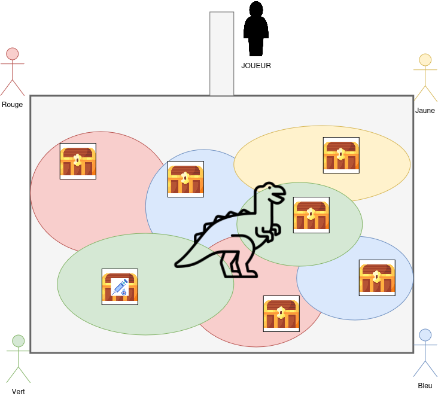
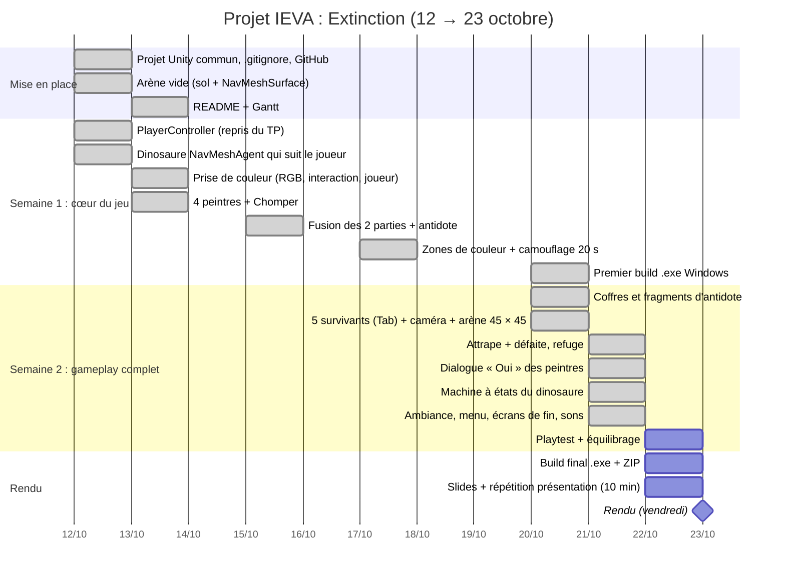

# Extinction — projet IEVA (groupe 6 : Kenan & Alexandre)

- **Thème** : GGJ 2011 « Extinction »
- **Mécaniques** : Matcher (prendre la couleur du sol pour se cacher), Surpasser (échapper au dinosaure)
- **Diversifiers** : 5 *The World is Alive* (objets animés), 16 *Herding cats* (5 personnages contrôlés), 21 *Forrest Gump* (seule réponse possible : « Oui »)

## Le jeu

Cinq survivants partent d'un refuge pour reconstituer l'antidote qui sauvera l'humanité. Les fragments d'antidote sont cachés dans des coffres, au milieu d'une arène gardée par un dinosaure.

- On contrôle un survivant à la fois et on passe de l'un à l'autre avec `Tab`. Les autres restent sur place.
- Les peintres des quatre coins colorent le survivant (rouge, jaune, vert ou bleu). On ne peut leur répondre que « Oui ».
- Sur une zone de sa couleur, le survivant est caché du dinosaure pendant 20 s, puis la peinture sèche.
- Un coffre ne s'ouvre qu'avec la couleur de la zone où il est posé.
- Le dinosaure patrouille, puis poursuit le survivant actif dès qu'il est visible, et l'attrape s'il le touche.

**Victoire** : réunir les fragments d'antidote. **Défaite** : les cinq survivants sont attrapés.

## Lancer le jeu

- **Exécutable** : lancer le `.exe` fourni dans le ZIP (Windows).
- **Projet** : ouvrir le dossier `IEVADINO` avec **Unity 6000.3.24f1**, ouvrir la scène `Assets/Scenes/Menu.unity`, puis Play.

| Action | Touche |
|---|---|
| Avancer / reculer, tourner | Flèches (ou ZQSD / WASD) |
| Changer de survivant | `Tab` |
| Parler à un peintre, répondre « Oui », ouvrir un coffre | `E` |

## Qui a fait quoi

**Kenan**
- Prise de couleur : lecture du RGB d'un material, interaction avec la touche E, couleur appliquée au personnage (`ColorSource`, `ColorInteraction`, `PlayerColor`)
- Dinosaure Chomper : intégration du modèle du TP et passage des materials en URP
- Zones de couleur et camouflage de 20 s (`PlayerHiding`)
- Arène 45 × 45, caméra qui suit le survivant actif, 5 survivants et changement avec `Tab` (`Survivor`, `SurvivorManager`, `SurvivorHud`, `CameraFollow`)
- Machine à états du dinosaure dans l'Animator : Patrouille, Poursuite, Attaque, un script par état (`DinoPatrolState`, `DinoChaseState`, `DinoAttackState`, `DinoSettings`)
- Animations d'ambiance (`AliveIdle`), menu principal, écrans de victoire et de défaite, sons et musiques
- Organisation finale du projet : scènes `Menu` et `Jeu`, prefabs `Dino` et `Peintre`

**Alexandre**
- Création du projet Unity commun, du dépôt GitHub, du README et du Gantt
- Contrôleur du joueur repris du TP, puis passé en physique (Rigidbody, `FixedUpdate`)
- Premier dinosaure avec NavMesh, puis attrape des survivants et défaite (`DinoCatcher`)
- Refactorisation en composants, événements et ScriptableObjects (`ColorData`, `GameRules`, `IInteractable`, `Interactor`)
- Construction de la carte (murs, obstacles, refuge et passerelle) et coffres contenant les fragments d'antidote (`Chest`, `ChestLoot`, `AntidoteFragment`, `SafeZone`)
- Dialogues « Oui » des peintres (`NpcDialogue`, `DialogueData`) et coffres verrouillés par couleur
- Premier build Windows

**Ensemble** : choix du concept et du gameplay, fusion des deux parties, tests et équilibrage.

## Architecture

Une fonctionnalité = un composant (`MonoBehaviour`). Les composants communiquent par événements (`Action`) et les réglages sont dans des `ScriptableObject` (`Assets/Data`).

| Élément | Composants |
|---|---|
| Survivant (prefab `Player`) | `PlayerController`, `PlayerColor`, `PlayerHiding`, `Interactor`, `Survivor` (`ICatchable`) |
| Survivants | `SurvivorManager`, `SurvivorHud`, `CameraFollow`, `SafeZone` |
| Couleurs | `ColorData`, `ColorSource`, `ColorZone`, `ColorInteraction`, `TriggerSet` |
| Peintre (prefab `Peintre`) | `NpcDialogue`, `DialogueData`, `ColorInteraction`, `AliveIdle` |
| Dinosaure (prefab `Dino`) | `DinoController` + Animator `Dino.controller` (`DinoPatrolState`, `DinoChaseState`, `DinoAttackState`), `DinoSettings`, `DinoCatcher`, `DinoFollowActiveSurvivor` |
| Partie | `GameManager`, `GameRules`, `Chest`, `ChestLoot`, `AntidoteFragment`, `EndScreen`, `MainMenu`, `GameSounds` |

## Crédits audio (CC0)

- Effets sonores : [Kenney](https://kenney.nl) — Interface Sounds, Impact Sounds, Music Jingles
- Musiques : SRG774 — [Dark Sci-Fi Audio Pack](https://opengameart.org/content/dark-sci-fi-audio-pack)

## Planning

