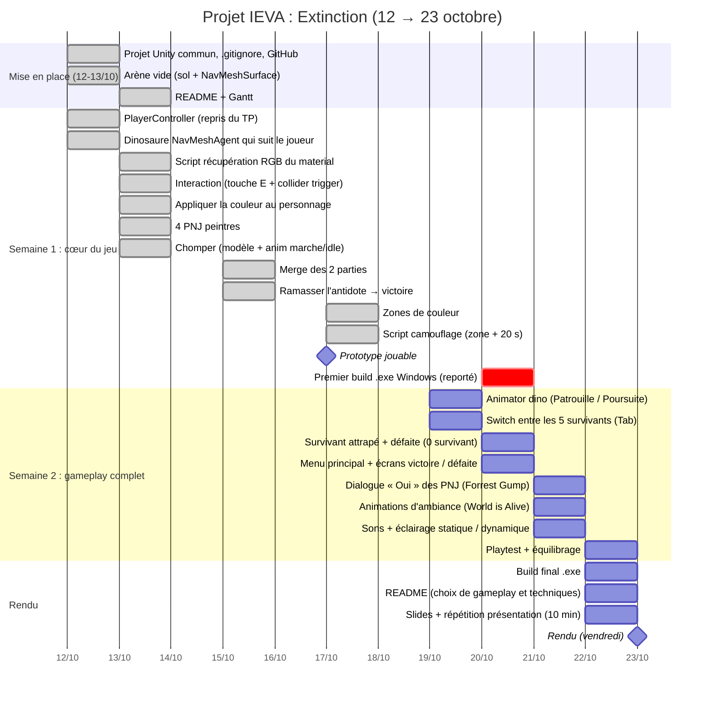

# IEVA

6,Kenan&Alexandre,"2011: ""Extinction""",Matcher,Surpasser,5,16,21

- 5. The World is Alive Even stationary objects have some animations.
- 16. Herding cats The player controls five or more characters.
- 21. Forrest Gump: The character only has the "Yes" option in all dialogues with NPCs.

## Le jeu

Cinq survivants doivent récupérer l'antidote gardé par un dinosaure. L'arène est divisée en zones de couleur.
Le joueur contrôle un survivant à la fois et passe de l'un à l'autre avec `Tab`.
En parlant aux PNJ des coins (une seule réponse possible : « Oui »), le survivant prend leur couleur.
Si sa couleur correspond à la zone où il se trouve, il est caché du dinosaure pendant 20 s.
Le dinosaure patrouille, puis poursuit les survivants visibles. **Victoire** : ramasser l'antidote. **Défaite** : les 5 survivants sont attrapés.

Utilisation des scripts du TP d'intro (`PlayerController`, `SingleAgentController`, `ChomperBehaviour`, `OpenLevel`, `PlatformSpawner`)

## Avancement

**Lundi 12 octobre** : étapes 0, 1 et 2 du mail de Yann terminées.

- [x] Projet Unity commun `IEVADINO` (Unity 6, URP) + `.gitignore`
- [x] Player Controller : `PlayerController.cs` du TP, sur le prefab du bonhomme vert du TP
- [x] PNJ dinosaure : cylindre + NavMeshAgent + `DinoController.cs` (repris de `SingleAgentController`), NavMeshSurface sur le sol
- [x] Ramasser un objet pour gagner : `Antidote.cs` (15/10)
- [x] Récupérer le RGB d'un material : `ColorSource.cs` (13/10)
- [x] Interaction (touche + collider) : `ColorInteraction.cs`, touche E (13/10)
- [x] Appliquer la couleur au personnage : `PlayerColor.cs` (13/10)
- [x] Placer les PNJ / objets qui donnent les couleurs : 4 PNJ peintres (13/10) + 8 zones de couleur (17/10)
- [x] Script caché (20 s) : `PlayerHiding.cs` (17/10)
- [ ] Animator / machine à états du dinosaure (fait : Chomper + anim marche/idle `DinoAnimation.cs` ; reste : patrouille / poursuite)
- [ ] Scripts perdre et gagner (fait : gagner ; reste : perdre)

## Diagramme de Gantt

